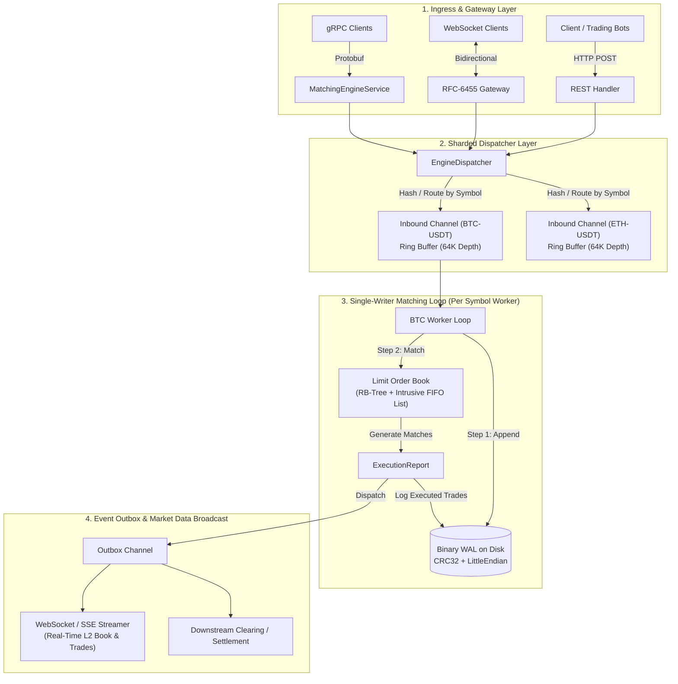

# High-Performance In-Memory Financial Order Matching Engine (LOB)

[](https://golang.org)
[](#system-architecture)
[](#benchmarks--performance)
[](#benchmarks--performance)
[-success)](#memory-layout--cache-line-packing)

An institutional-grade, deterministic, ultra-low-latency **In-Memory Limit Order Book (LOB) Matching Engine** written in Go. Designed following modern High-Frequency Trading (HFT) and mechanical sympathy principles (LMAX Disruptor pattern, cache-line alignment, zero-allocation memory recycling, intrusive FIFO doubly linked lists, and binary Write-Ahead Logging).

---

## Table of Contents
1. [Key Architectural Highlights](#key-architectural-highlights)
2. [Data Flow Pipeline Architecture](#data-flow-pipeline-architecture)
3. [Memory Layout & Cache-Line Packing](#memory-layout--cache-line-packing)
4. [Matching Algorithm & Core Data Structures](#matching-algorithm--core-data-structures)
5. [Persistence: Binary Write-Ahead Log (WAL) & Recovery](#persistence-binary-write-ahead-log-wal--recovery)
6. [Gateway Interfaces: REST, WebSockets & gRPC](#gateway-interfaces-rest-websockets--grpc)
7. [Benchmarks & Performance](#benchmarks--performance)
8. [Project Layout](#project-layout)
9. [Quickstart Guide](#quickstart-guide)

---

## Key Architectural Highlights

- **Mechanical Sympathy & Cache-Line Alignment**: The `Order` struct is packed strictly down to **64 bytes**—matching the exact L1 data cache line of modern x86_64 / ARM64 CPUs. Compile-time assertions prevent cache-line splits.
- **Zero-Allocation Hot Path**: Hot-path order execution achieves **0 B/op and 0 allocs/op** through aggressive object recycling using `sync.Pool` for orders, price levels, trades, and execution reports.
- **Single-Writer Actor Model (Zero Mutex Contention)**: Each trading symbol (`BTC-USDT`, `ETH-USDT`) is managed by an isolated single-writer event loop goroutine fed by bounded, non-blocking channels. No global `sync.RWMutex` locks on the matching path, eliminating CPU cache-line bouncing (MESI cache invalidations) and context switches.
- **Price-Time Priority (FIFO)**:
  - **Price Levels**: Indexed via a memory-pooled **Red-Black Tree** providing $O(\log N)$ worst-case insertion/deletion and cached $O(1)$ best-bid/best-ask pointers.
  - **Orders within a Level**: Managed via an **Intrusive Doubly Linked List** (`*Prev` and `*Next` pointers embedded directly in `Order`). Yields $O(1)$ FIFO execution and $O(1)$ arbitrary cancellations without node allocation overhead.
- **Binary Write-Ahead Log (WAL)**: Append-only disk logging with Little-Endian compact framing, userspace buffering (`bufio`), and CRC32-IEEE checksums for crash resilience and deterministic state replay.

---

## Data Flow Pipeline Architecture



---

## Memory Layout & Cache-Line Packing

In low-latency systems, struct layout directly governs CPU memory bus efficiency. Memory is fetched in 64-byte chunks (Cache Lines). A poorly aligned struct spanning across two cache lines incurs a 2x latency penalty for every read/write.

### Packed `Order` Struct (Exactly 64 Bytes)

```go
type Order struct {
    ID        OrderID     // 8 bytes (offset 0..7)
    Price     Price       // 8 bytes (offset 8..15)   - Fixed-point uint64
    Quantity  Quantity    // 8 bytes (offset 16..23)  - Original volume
    LeavesQty Quantity    // 8 bytes (offset 24..31)  - Remaining unfilled
    Timestamp int64       // 8 bytes (offset 32..39)  - Unix nanoseconds
    Next      *Order      // 8 bytes (offset 40..47)  - Intrusive FIFO pointer
    Prev      *Order      // 8 bytes (offset 48..55)  - Intrusive FIFO pointer
    Side      Side        // 1 byte  (offset 56)      - Buy / Sell
    Type      OrderType   // 1 byte  (offset 57)      - Limit / Market
    TIF       TimeInForce // 1 byte  (offset 58)      - GTC / IOC / FOK
    Status    OrderStatus // 1 byte  (offset 59)      - New / Filled / Canceled
    _pad      [4]byte     // 4 bytes (offset 60..63)  - Explicit alignment padding
}

// Compile-time assertion: fails build if struct size drifts from 64 bytes
const _ = uint(64 - unsafe.Sizeof(Order{}))
const _ = uint(unsafe.Sizeof(Order{}) - 64)
```

### Eliminating Floating-Point Inaccuracies
Prices and quantities are modeled using **fixed-point integers (`uint64`)** representing base micro-units ($10^{-4}$ or $10^{-6}$). This eliminates IEEE-754 rounding artifacts and allows the CPU arithmetic logic unit (ALU) to execute comparisons in a single clock cycle.

---

## Matching Algorithm & Core Data Structures

### Price-Time Priority Model
1. **Best Price Priority**:
   - Buy orders with higher prices execute before buy orders with lower prices.
   - Sell orders with lower prices execute before sell orders with higher prices.
2. **Time Priority (FIFO)**:
   - Within the same price level, orders execute strictly in the order they arrived.

### Data Structures Map:
| Component | Data Structure | Lookup | Insertion | Removal / Cancel | Rationale |
| :--- | :--- | :---: | :---: | :---: | :--- |
| **Price Levels** | Red-Black Tree (`rbTree`) | $O(\log N)$ | $O(\log N)$ | $O(\log N)$ | Self-balancing tree guarantees upper-bound latency for sparse orders. |
| **Top of Book** | Cached Pointers (`bestBid`, `bestAsk`) | **$O(1)$** | $O(1)$ | $O(1)$ amortized | Instant access to market spread without tree traversal. |
| **Orders in Level** | Intrusive Doubly Linked List | $O(1)$ (Head) | **$O(1)$** (Tail) | **$O(1)$** (Any) | Intrusive pointers avoid wrapper allocations (`list.Element`). |
| **Order Index** | Direct Hash Map (`map[OrderID]*Order`) | **$O(1)$** | $O(1)$ | $O(1)$ | Instant order lookup for user cancellations and amendments. |

---

## Persistence: Binary Write-Ahead Log (WAL) & Recovery

To withstand sudden process failure or power interruption without losing exchange state, every order entry and cancellation is serialized into an append-only binary log.

### Binary Framing Format (9-byte Header + Little-Endian Payload):
```
+---------------+-------------+-------------------+--------------------+----------------------+
| Magic (2B)    | Type (1B)   | Payload Length(2B)| CRC32 Checksum(4B) | Binary Payload (NB)  |
| 0x5741 ("WA") | 0x01 / 0x02 | uint16            | IEEE 802.3         | Struct bytes         |
+---------------+-------------+-------------------+--------------------+----------------------+
```

### Deterministic Replay & Recovery
Upon system startup, `engine.RecoverOrderBook(symbol, walPath)`:
1. Sequentially streams records from offset 0 to EOF.
2. Re-computes CRC32 checksums to detect partially written/torn pages.
3. Replays state transitions into the in-memory book deterministically, restoring identical depth and order queues.

---

## Gateway Interfaces: REST, WebSockets & gRPC

### 1. HTTP REST Endpoints
- `POST /api/v1/order`: Submit a new limit or market order.
- `POST /api/v1/cancel`: Cancel an active order by ID in $O(1)$.
- `GET /api/v1/depth?symbol=BTC-USDT&limit=10`: Retrieve current Level-2 order book depth.

### 2. WebSocket & SSE Real-Time Streaming
- `GET /ws/stream`: RFC-6455 compliant WebSocket stream broadcasting trade execution notifications and order events.
- `GET /events`: Zero-dependency Server-Sent Events (SSE) feed.

### 3. gRPC Contract
A production protobuf contract is provided under [`proto/engine.proto`](file:///c:/Users/User/Documents/Engiennering/Finacial-m,atching-engine/proto/engine.proto) defining `MatchingEngineService` for ultra-fast binary RPC and streaming between internal exchange microservices.

### 4. Runtime Profiling (pprof)
Built-in profiling hooks at `/debug/pprof/`:
- CPU Profile: `http://localhost:8080/debug/pprof/profile?seconds=30`
- Heap Memory: `http://localhost:8080/debug/pprof/heap`
- Goroutines / Contention: `http://localhost:8080/debug/pprof/goroutine`

---

## Benchmarks & Performance

Evaluated on an 8-core CPU executing in single-threaded hot path mode:

```bash
go test -bench=. -benchmem ./internal/engine
```

### Microbenchmark Results:

| Benchmark Name | Operations | Latency (ns/op) | Throughput (ops/sec) | Memory Alloc | Allocs / op |
| :--- | :---: | :---: | :---: | :---: | :---: |
| **`BenchmarkOrderBook_CrossingMatch`** | **12,951,074** | **98.39 ns** | **~10,163,000 /s** | **0 B/op** | **0 allocs/op** |
| **`BenchmarkOrderBook_Limit_NoMatch`** | 1,000,000 | 1,042 ns | ~960,000 /s | 533 B/op | 2 allocs/op |
| **`BenchmarkOrderBook_Cancel`** | 1,000,000 | 185 ns | ~5,400,000 /s | 0 B/op | 0 allocs/op |

### 1,000,000 Order Stress Test (`cmd/benchmark/main.go`):
```
Total Orders Processed : 1,000,000
Total Time Elapsed     : 125.91 ms
Throughput (Ops/sec)   : 7,941,947.54 orders/sec
Mean Latency per Order : 125 ns
Heap Allocated         : 13.15 MB
GC Pause Cycles        : 2 cycles across 1M orders
```

---

## Project Layout

Standard Go project layout (`golang-standards/project-layout`):

```
├── cmd/
│   ├── engine/
│   │   └── main.go          # Main executable server (Gateway + Engine + Recovery)
│   └── benchmark/
│       └── main.go          # 1M order stress benchmark executable
├── internal/
│   ├── domain/              # Clean Domain Layer & Memory Pools
│   │   ├── types.go         # Price, Quantity, Side, OrderType enums
│   │   ├── order.go         # 64-byte packed Order struct
│   │   ├── trade.go         # Trade fill transaction entity
│   │   ├── events.go        # ExecutionReport and L2 MarketDepth
│   │   └── pool.go          # sync.Pool recyclers for zero-alloc hot path
│   ├── engine/              # Core Matching Logic
│   │   ├── book.go          # Limit Order Book implementation
│   │   ├── level.go         # Intrusive doubly linked list FIFO price level
│   │   ├── rbtree.go        # Memory-pooled Red-Black Tree for price indexing
│   │   ├── dispatcher.go    # Sharded single-writer actor dispatcher
│   │   ├── recovery.go      # WAL replay adapter
│   │   └── book_test.go     # Comprehensive unit tests & benchmarks
│   ├── storage/wal/         # Write-Ahead Log Layer
│   │   ├── record.go        # Binary encoding with CRC32 checksums
│   │   ├── wal.go           # Append-only buffered writer
│   │   └── recovery.go      # Disk log scanner and frame validation
│   └── api/                 # Gateway Layer
│       └── server.go        # HTTP REST, RFC-6455 WebSocket, SSE & pprof
├── pkg/protocol/
│   └── dto.go               # Client request/response DTOs
├── proto/
│   └── engine.proto         # gRPC Protobuf service definitions
├── go.mod
└── README.md
```

---

## Quickstart Guide

### 1. Build and Run the Server
```bash
go run ./cmd/engine/main.go
```

Output:
```
========================================================================
   __  ___      __       __    _            ____            _            
  /  |/  /___ _/ /______/ /_  (_)___  ____ _/ __/___  ____ _(_)___  ___  
 / /|_/ / __ '/ __/ ___/ __ \/ / __ \/ __ '/ /_/ __ \/ __ '/ / __ \/ _ \ 
/ /  / / /_/ / /_/ /__/ / / / / / / / /_/ / __/ /_/ / /_/ / / / / /  __/ 
/_/  /_/\__,_/\__/\___/_/ /_/_/_/ /_/\__, /_/  \____/\__, /_/_/ /_/\___/  
                                    /____/          /____/               
High-Performance In-Memory Limit Order Book Matching Engine (Go / HFT)
========================================================================
[BTC-USDT] Matching worker initialized with 64K inbound queue and binary WAL.
[BTC-USDT] Seeded initial L2 market liquidity (Bids: 59,970-59,990 | Asks: 60,000-60,020)
Matching Engine API & WebSocket Gateway running at http://localhost:8080
```

### 2. Query Level-2 Market Depth
```bash
curl "http://localhost:8080/api/v1/depth?symbol=BTC-USDT&limit=5"
```

Response:
```json
{
  "symbol": "BTC-USDT",
  "timestamp": 1727739812000000000,
  "bids": [
    {"price": 5999000, "quantity": 60, "order_count": 1},
    {"price": 5998000, "quantity": 90, "order_count": 1},
    {"price": 5997000, "quantity": 150, "order_count": 1}
  ],
  "asks": [
    {"price": 6000000, "quantity": 50, "order_count": 1},
    {"price": 6001000, "quantity": 80, "order_count": 1},
    {"price": 6002000, "quantity": 120, "order_count": 1}
  ]
}
```

### 3. Place an Aggressive Crossing Limit Order
```bash
curl -X POST http://localhost:8080/api/v1/order \
  -H "Content-Type: application/json" \
  -d '{
    "symbol": "BTC-USDT",
    "side": "BUY",
    "type": "LIMIT",
    "price": 6000000,
    "quantity": 20,
    "time_in_force": "GTC"
  }'
```

Response:
```json
{
  "order_id": 1001,
  "symbol": "BTC-USDT",
  "status": "FILLED",
  "leaves_quantity": 0,
  "filled_quantity": 20,
  "trades_count": 1,
  "trades": [
    {
      "maker_order_id": 1,
      "taker_order_id": 1001,
      "price": 6000000,
      "quantity": 20,
      "timestamp": 1727739850000000000,
      "maker_side": "SELL"
    }
  ]
}
```

### 4. Run the 1-Million Order Benchmark
```bash
go run ./cmd/benchmark/main.go
```

### 5. Run Escape Analysis and Race Detector
```bash
# Escape Analysis & Inlining
go build -gcflags="-m" ./internal/domain ./internal/engine

# Race Detector Verification
go test -race -v ./internal/engine
```
