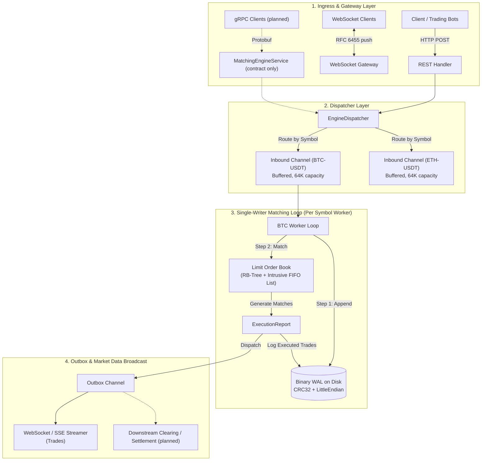

# In-Memory Order Matching Engine (Limit Order Book) in Go

[](https://golang.org)
[](#data-flow-pipeline-architecture)
[](#persistence-binary-write-ahead-log-wal--recovery)

A deterministic **in-memory Limit Order Book (LOB) matching engine** written in Go. It implements price-time priority with a red-black tree of price levels and intrusive FIFO lists, a single-writer goroutine per symbol fed by buffered channels, `sync.Pool` object recycling, a binary write-ahead log with CRC32 replay, and a small REST / WebSocket / SSE gateway. The design borrows ideas from low-latency trading systems (mechanical sympathy, single-writer principle) and is meant as a study of data structures and concurrency in Go.

> **Scope:** personal learning project with synthetic orders; it is not connected to any market and is not used in production.
> - **Implemented:** order book with limit/market orders and GTC/IOC/FOK, red-black tree price index with cached best bid/ask, intrusive doubly linked FIFO levels, O(1) cancel via an order index, 64-byte `Order` struct with a compile-time size check, `sync.Pool` recycling, per-symbol worker goroutines, binary WAL (orders, cancels, trades) with CRC32 and startup replay, REST + hand-written RFC 6455 WebSocket push + SSE + pprof, 6 unit tests and 3 benchmarks, and a 1M-order stress program.
> - **Not implemented / planned:** a gRPC server (only the [`proto/engine.proto`](proto/engine.proto) contract exists; there is no generated code or gRPC dependency), downstream clearing/settlement, CI, WAL corruption/truncation tests, and published benchmark results with hardware details.
> - **Performance:** no benchmark results are published. Run the commands in [Benchmarks](#benchmarks--performance) to measure on your own hardware.

---

## Table of Contents
1. [Key Architectural Highlights](#key-architectural-highlights)
2. [Data Flow Pipeline Architecture](#data-flow-pipeline-architecture)
3. [Memory Layout & Cache-Line Packing](#memory-layout--cache-line-packing)
4. [Matching Algorithm & Core Data Structures](#matching-algorithm--core-data-structures)
5. [Persistence: Binary Write-Ahead Log (WAL) & Recovery](#persistence-binary-write-ahead-log-wal--recovery)
6. [Gateway Interfaces: REST, WebSockets & gRPC](#gateway-interfaces-rest-websockets--grpc)
7. [Benchmarks & Performance](#benchmarks--performance)
8. [Project Layout](#project-layout)
9. [Quickstart Guide](#quickstart-guide)

---

## Key Architectural Highlights

- **Cache-Line-Sized Orders**: The `Order` struct is packed to exactly **64 bytes**, the common L1 cache-line size on x86_64 / ARM64. Compile-time assertions fail the build if the size drifts.
- **Allocation-Conscious Hot Path**: Orders, price levels, tree nodes, trades and execution reports are recycled with `sync.Pool`. The crossing-match benchmark is designed to run without heap allocations; resting new orders still allocates (map insertion, new levels). Use `-benchmem` to check.
- **Single-Writer per Symbol**: Each trading symbol (`BTC-USDT`, `ETH-USDT`, `SOL-USDT`) is owned by one event-loop goroutine fed by a bounded, non-blocking channel. The order book itself needs no mutex; the dispatcher only takes a read lock to look up the symbol's worker. This is the single-writer principle popularized by LMAX, implemented with Go channels rather than a ring buffer.
- **Price-Time Priority (FIFO)**:
  - **Price Levels**: Indexed via a pooled **Red-Black Tree** with $O(\log N)$ insertion/deletion and cached $O(1)$ best-bid/best-ask pointers.
  - **Orders within a Level**: An **intrusive doubly linked list** (`Prev`/`Next` pointers embedded in `Order`), giving $O(1)$ FIFO execution and $O(1)$ cancellation without wrapper nodes.
- **Binary Write-Ahead Log (WAL)**: Append-only log with little-endian framing, `bufio` buffering and CRC32-IEEE checksums, replayed at startup to rebuild the book.

---

## Data Flow Pipeline Architecture



---

## Memory Layout & Cache-Line Packing

CPUs fetch memory in cache lines (typically 64 bytes). A struct that straddles two cache lines can require two fetches per access, so the hot `Order` struct is laid out to fit exactly one line.

### Packed `Order` Struct (Exactly 64 Bytes)

```go
type Order struct {
    ID        OrderID     // 8 bytes (offset 0..7)
    Price     Price       // 8 bytes (offset 8..15)   - Fixed-point uint64
    Quantity  Quantity    // 8 bytes (offset 16..23)  - Original volume
    LeavesQty Quantity    // 8 bytes (offset 24..31)  - Remaining unfilled
    Timestamp int64       // 8 bytes (offset 32..39)  - Unix nanoseconds
    Next      *Order      // 8 bytes (offset 40..47)  - Intrusive FIFO pointer
    Prev      *Order      // 8 bytes (offset 48..55)  - Intrusive FIFO pointer
    Side      Side        // 1 byte  (offset 56)      - Buy / Sell
    Type      OrderType   // 1 byte  (offset 57)      - Limit / Market
    TIF       TimeInForce // 1 byte  (offset 58)      - GTC / IOC / FOK
    Status    OrderStatus // 1 byte  (offset 59)      - New / Filled / Canceled
    _pad      [4]byte     // 4 bytes (offset 60..63)  - Explicit alignment padding
}

// Compile-time assertion: fails build if struct size drifts from 64 bytes
const _ = uint(64 - unsafe.Sizeof(Order{}))
const _ = uint(unsafe.Sizeof(Order{}) - 64)
```

Note: the size check guarantees 64 bytes, but Go does not guarantee 64-byte *alignment* of heap objects, so an order may still start mid-line.

### Avoiding Floating-Point Errors
Prices and quantities are fixed-point integers (`uint64`) in minor units. This avoids IEEE-754 rounding issues and keeps comparisons as plain integer operations.

---

## Matching Algorithm & Core Data Structures

### Price-Time Priority Model
1. **Best Price Priority**:
   - Buy orders with higher prices execute before buy orders with lower prices.
   - Sell orders with lower prices execute before sell orders with higher prices.
2. **Time Priority (FIFO)**:
   - Within the same price level, orders execute strictly in the order they arrived.

### Data Structures Map:
| Component | Data Structure | Lookup | Insertion | Removal / Cancel | Rationale |
| :--- | :--- | :---: | :---: | :---: | :--- |
| **Price Levels** | Red-Black Tree (`rbTree`) | $O(\log N)$ | $O(\log N)$ | $O(\log N)$ | Self-balancing tree bounds the worst case for sparse books. |
| **Top of Book** | Cached Pointers (`bestBid`, `bestAsk`) | **$O(1)$** | $O(1)$ | $O(1)$ amortized | Access to the spread without tree traversal. |
| **Orders in Level** | Intrusive Doubly Linked List | $O(1)$ (Head) | **$O(1)$** (Tail) | **$O(1)$** (Any) | Intrusive pointers avoid wrapper allocations (`list.Element`). |
| **Order Index** | Hash Map (`map[OrderID]*Order`) | **$O(1)$** | $O(1)$ | $O(1)$ | Direct order lookup for cancellations. |

---

## Persistence: Binary Write-Ahead Log (WAL) & Recovery

Every new order, cancellation and executed trade is serialized into an append-only binary log so the book can be rebuilt after a restart.

### Binary Framing Format (9-byte Header + Little-Endian Payload):
```
+---------------+-------------+-------------------+--------------------+----------------------+
| Magic (2B)    | Type (1B)   | Payload Length(2B)| CRC32 Checksum(4B) | Binary Payload (NB)  |
| 0x5741 ("WA") | 0x01 - 0x03 | uint16            | IEEE 802.3         | Struct bytes         |
+---------------+-------------+-------------------+--------------------+----------------------+
```

### Deterministic Replay & Recovery
On startup, `engine.RecoverOrderBook(symbol, walPath)`:
1. Streams records sequentially from offset 0 to EOF.
2. Re-computes CRC32 checksums to detect torn or partially written records.
3. Replays the state transitions into the in-memory book.

Durability trade-off: the server opens the WAL with buffered writes and without `fsync` on every append, so records still in the buffer can be lost on a crash or power failure. Append errors are currently not surfaced to the caller.

---

## Gateway Interfaces: REST, WebSockets & gRPC

### 1. HTTP REST Endpoints
- `POST /api/v1/order`: Submit a new limit or market order.
- `POST /api/v1/cancel`: Cancel an active order by ID in $O(1)$.
- `GET /api/v1/depth?symbol=BTC-USDT&limit=10`: Retrieve current Level-2 order book depth.

### 2. WebSocket & SSE Real-Time Streaming
- `GET /ws/stream`: WebSocket stream (RFC 6455 handshake and framing implemented by hand with the standard library) that pushes trade executions.
- `GET /events`: Server-Sent Events (SSE) feed with no external dependencies.

### 3. gRPC Contract (server planned)
A protobuf contract is provided in [`proto/engine.proto`](proto/engine.proto), defining a `MatchingEngineService`. The gRPC server is **not implemented yet**: there is no generated code and `go.mod` has no gRPC dependency.

### 4. Runtime Profiling (pprof)
Profiling endpoints at `/debug/pprof/`:
- CPU Profile: `http://localhost:8080/debug/pprof/profile?seconds=30`
- Heap Memory: `http://localhost:8080/debug/pprof/heap`
- Goroutines: `http://localhost:8080/debug/pprof/goroutine`

---

## Benchmarks & Performance

The repository includes three Go microbenchmarks and a stress program. No results are published here because they have not been recorded with hardware details or reproduced in CI; run them locally:

```bash
# Microbenchmarks (ns/op, B/op, allocs/op)
go test -bench=. -benchmem ./internal/engine

# 1,000,000-order stress run (throughput, mean latency, heap, GC cycles)
go run ./cmd/benchmark/main.go
```

| Benchmark | What it measures |
| :--- | :--- |
| `BenchmarkOrderBook_CrossingMatch` | An aggressive order fully matching a resting order (hot path, intended to be allocation-free). |
| `BenchmarkOrderBook_Limit_NoMatch` | Inserting a non-crossing limit order that rests in the book (allocates for map and level entries). |
| `BenchmarkOrderBook_Cancel` | Cancelling a resting order by ID. |

---

## Project Layout

Standard Go project layout (`golang-standards/project-layout`):

```
├── cmd/
│   ├── engine/
│   │   └── main.go          # Server executable (Gateway + Engine + Recovery)
│   └── benchmark/
│       └── main.go          # 1M order stress program
├── internal/
│   ├── domain/              # Domain Layer & Memory Pools
│   │   ├── types.go         # Price, Quantity, Side, OrderType enums
│   │   ├── order.go         # 64-byte packed Order struct
│   │   ├── trade.go         # Trade fill entity
│   │   ├── events.go        # ExecutionReport and L2 MarketDepth
│   │   └── pool.go          # sync.Pool recyclers
│   ├── engine/              # Core Matching Logic
│   │   ├── book.go          # Limit Order Book implementation
│   │   ├── level.go         # Intrusive doubly linked list FIFO price level
│   │   ├── rbtree.go        # Pooled Red-Black Tree for price indexing
│   │   ├── dispatcher.go    # Per-symbol single-writer dispatcher
│   │   ├── recovery.go      # WAL replay adapter
│   │   └── book_test.go     # Unit tests & benchmarks
│   ├── storage/wal/         # Write-Ahead Log Layer
│   │   ├── record.go        # Binary encoding with CRC32 checksums
│   │   ├── wal.go           # Append-only buffered writer
│   │   └── recovery.go      # Log scanner and frame validation
│   └── api/                 # Gateway Layer
│       └── server.go        # HTTP REST, RFC 6455 WebSocket, SSE & pprof
├── pkg/protocol/
│   └── dto.go               # Client request/response DTOs
├── proto/
│   └── engine.proto         # gRPC service contract (server not implemented)
├── go.mod
└── README.md
```

---

## Quickstart Guide

### 1. Build and Run the Server
```bash
go run ./cmd/engine/main.go
```

Log output (abridged):
```
[BTC-USDT] Matching worker initialized with 64K inbound queue and binary WAL.
[BTC-USDT] Seeded initial L2 market liquidity (Bids: 59,970-59,990 | Asks: 60,000-60,020)
Matching Engine API & WebSocket Gateway running at http://localhost:8080
```

### 2. Query Level-2 Market Depth
```bash
curl "http://localhost:8080/api/v1/depth?symbol=BTC-USDT&limit=5"
```

Example response:
```json
{
  "symbol": "BTC-USDT",
  "timestamp": 1727739812000000000,
  "bids": [
    {"price": 5999000, "quantity": 60, "order_count": 1},
    {"price": 5998000, "quantity": 90, "order_count": 1},
    {"price": 5997000, "quantity": 150, "order_count": 1}
  ],
  "asks": [
    {"price": 6000000, "quantity": 50, "order_count": 1},
    {"price": 6001000, "quantity": 80, "order_count": 1},
    {"price": 6002000, "quantity": 120, "order_count": 1}
  ]
}
```

### 3. Place an Aggressive Crossing Limit Order
```bash
curl -X POST http://localhost:8080/api/v1/order \
  -H "Content-Type: application/json" \
  -d '{
    "symbol": "BTC-USDT",
    "side": "BUY",
    "type": "LIMIT",
    "price": 6000000,
    "quantity": 20,
    "time_in_force": "GTC"
  }'
```

Example response:
```json
{
  "order_id": 1001,
  "symbol": "BTC-USDT",
  "status": "FILLED",
  "leaves_quantity": 0,
  "filled_quantity": 20,
  "trades_count": 1,
  "trades": [
    {
      "maker_order_id": 1,
      "taker_order_id": 1001,
      "price": 6000000,
      "quantity": 20,
      "timestamp": 1727739850000000000,
      "maker_side": "SELL"
    }
  ]
}
```

### 4. Run the 1-Million Order Stress Program
```bash
go run ./cmd/benchmark/main.go
```

### 5. Run Escape Analysis and Race Detector
```bash
# Escape Analysis & Inlining
go build -gcflags="-m" ./internal/domain ./internal/engine

# Race Detector
go test -race -v ./internal/engine
```
